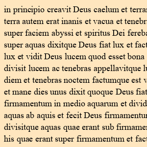

# Vulgate

[](https://www.repostatus.org/#wip)

[](http://www.etcbc.nl)

[](https://annotation.github.io/text-fabric/tf)

## About

This is the
[text-fabric](https://github.com/annotation/text-fabric)
representation of the Vulgate in the Stuttgart edition, *Biblia Sacra iuxta Vulgatam Versionem*,
with its critical apparatus, after the electronic text of the Oxford Text Archive (item 0319).

See [about](docs/about.md) for more information about this textual source,
and for the copyright and license of the data.

The conversion to Text-Fabric is the work of Rusty Taylor.

There is more information on the
[transcription](docs/transcription.md).

## How to use

### Having Text-Fabric installed

This data can be processed by
[Text-Fabric](https://annotation.github.io/text-fabric/tf).

After [installing Text-Fabric](https://annotation.github.io/text-fabric/tf/about/install.html),
you can start the Text-Fabric browser by this command

```sh
text-fabric rdtaylorjr/vulgate
```

Alternatively, you can work in a Jupyter notebook and say

```python
from tf.app import use

A = use('rdtaylorjr/vulgate')
```

See also
[start](https://nbviewer.jupyter.org/github/rdtaylorjr/vulgate/blob/main/tutorial/start.ipynb)
and
[search](https://nbviewer.jupyter.org/github/rdtaylorjr/vulgate/blob/main/tutorial/search.ipynb).

# Author

Rusty Taylor
